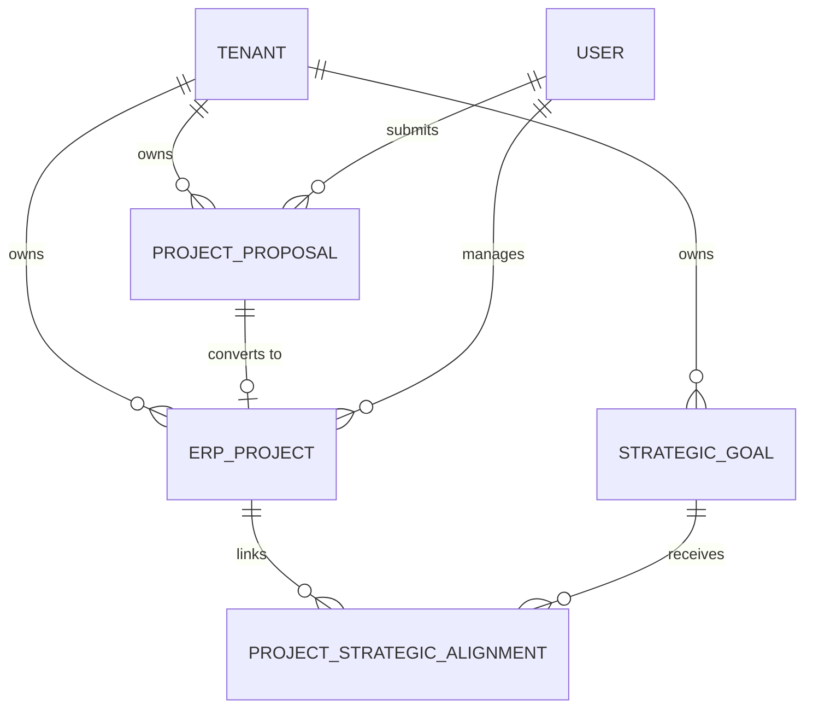

# EGOLYTICS MASTER PROMPT 02: R&D PORTFOLIO IMPLEMENTATION REPORT
**Platform:** EgoLytics – Research & Development Management Tool  
**Parent Ecosystem:** CRM nErgy Enterprise AI Platform  
**Phase:** Master Prompt 02 of 16  
**Requirement Focus:** Requirement 1 – Project Portfolio Management  
**Status:** FULLY IMPLEMENTED & DATABASE VERIFIED  

---

## 1. Executive Summary

In accordance with **Master Prompt 02** and the client authoritative specification (`EgoLytics - R_D Management Tool.docx`), this report documents the implementation of **Requirement 1 – Project Portfolio Management** within the EgoLytics R&D division.

Prior to this phase, the system contained an initial commercial ERP Projects table (`erp_projects`) tied strictly to commercial CRM deal handoffs. Research and development projects were absent, portfolio rollups did not exist, and there was no mechanism to track uncertain, multi-year scientific initiatives.

Through safe, non-destructive additive schema migrations and high-performance backend services, the application now provides:
- High-level multi-initiative portfolio tracking with live database rollups.
- Dynamic aggregation of total R&D budget ($), total spent ($), portfolio variance, budget utilization (%), average initiative progress (%), average ROI, and risk score metrics.
- Multi-dimensional status, priority tier (`CRITICAL`, `HIGH`, `MEDIUM`, `LOW`), and strategic category filtering.
- Full traceability to intake proposal origins (`referenceNumber`) and linked strategic enterprise goals.

---

## 2. Architecture & Existing ERP Module Adaptation

### 2.1 Reused vs. Extended Entities
Rather than creating an isolated, duplicative projects table that would fragment company-wide reporting, the existing `erp_projects` entity was intelligently extended with non-destructive, additive attributes:

| Entity / Field | Type | Origin | Purpose in EgoLytics R&D |
| :--- | :--- | :--- | :--- |
| `erp_projects.id` | CUID | Existing | Unique initiative identifier across ERP and R&D. |
| `erp_projects.tenantId` | CUID | Existing | Multi-tenant isolation partition. |
| `erp_projects.name` | String | Existing | Title of research initiative. |
| `erp_projects.client` | String | Existing | Sponsoring department or client. |
| `erp_projects.budget` | Decimal | Existing | Financial budget allocated to initiative. |
| `erp_projects.spent` | Decimal | Existing | Realized expenditures. |
| `erp_projects.progress` | Int | Existing | 0-100% completion milestone progress. |
| `erp_projects.status` | String | Existing | Lifecycle status (`Planning`, `In Progress`, `Completed`, `On Hold`). |
| `erp_projects.projectType` | String | **Added (Prompt 02)** | Discriminator: `'COMMERCIAL'` (ERP) vs. `'R_AND_D'` (EgoLytics). |
| `erp_projects.priority` | String | **Added (Prompt 02)** | Priority tier: `'CRITICAL'`, `'HIGH'`, `'MEDIUM'`, `'LOW'`. |
| `erp_projects.priorityScore` | Double | **Added (Prompt 02)** | 0-100 Composite score generated by Prioritization Engine. |
| `erp_projects.riskScore` | Double | **Added (Prompt 02)** | Technical and delivery uncertainty factor (0-100). |
| `erp_projects.roiScore` | Double | **Added (Prompt 02)** | Expected scientific / commercial return score (0-100). |
| `erp_projects.feasibilityScore`| Double | **Added (Prompt 02)** | Technical feasibility rating (0-100). |
| `erp_projects.strategicCategory` | String | **Added (Prompt 02)** | Innovation classification (e.g., Breakthrough, Core). |
| `erp_projects.stage` | String | **Added (Prompt 02)** | Stage-gate status (default: `APPROVED_INTAKE` or `IDEA`). |
| `erp_projects.startDate` | DateTime | **Added (Prompt 02)** | Project kickoff date. |
| `erp_projects.isArchived` | Boolean | **Added (Prompt 02)** | Soft-delete / archiving flag. |

### 2.2 Entity Relationship Diagram (ERD)



---

## 3. Backend Implementation & APIs

The portfolio backend is built with strict multi-tenant isolation, structured error handling, and parallelized database aggregation queries:

- **Service:** `backend/src/services/rdPortfolioService.js`
- **Controller:** `backend/src/controllers/rdPortfolioController.js`
- **Routes:** `backend/src/routes/rdRoutes.js`

### API Endpoint Reference:

#### 1. `GET /api/rd/portfolio`
- **Description:** Returns paginated initiatives and real-time aggregate portfolio summary rollups.
- **Query Parameters:** `page`, `limit`, `search`, `status`, `priority`, `strategicCategory`, `projectType`.
- **Response Rollups Payload:**
```json
{
  "success": true,
  "data": {
    "projects": [...],
    "rollups": {
      "totalProjects": 12,
      "activeProjects": 8,
      "completedProjects": 2,
      "totalBudget": 1450000.00,
      "totalSpent": 482000.00,
      "budgetVariance": 968000.00,
      "budgetUtilization": "33.2",
      "avgProgress": "46.5",
      "avgRoiScore": "78.2",
      "avgRiskScore": "28.5",
      "avgPriorityScore": "74.1",
      "statusBreakdown": { "Planning": 3, "In Progress": 5, "Completed": 2, "On Hold": 2 },
      "priorityBreakdown": { "CRITICAL": 4, "HIGH": 5, "MEDIUM": 2, "LOW": 1 },
      "categoryBreakdown": { "Core Innovation": 6, "Breakthrough Research": 4, "Sustainability": 2 }
    },
    "pagination": { "page": 1, "limit": 20, "total": 12, "totalPages": 1 }
  }
}
```

#### 2. `POST /api/rd/portfolio`
- **Description:** Direct creation of an active R&D initiative.
- **Payload:** `name`, `client`, `budget`, `manager`, `priority`, `strategicCategory`, `startDate`, `deadline`, `roiScore`, `riskScore`, `feasibilityScore`.

#### 3. `GET /api/rd/portfolio/:id`
- **Description:** Comprehensive detail view including proposal origin, assigned manager, and mapped strategic goals.

#### 4. `PUT /api/rd/portfolio/:id`
- **Description:** Updates initiative budget, spent expenditures, completion progress, priority tier, and stage-gate progress.

---

## 4. Frontend UI Implementation

The frontend is implemented in `frontend/src/pages/rd/RdPortfolio.jsx` and surfaced directly in `EgolyticsHub.jsx` and the main CRM/R&D sidebar navigation.

### Key UI Features:
1. **Executive Rollup Cards:**
   - Real-time display of total initiatives, active execution count, total portfolio budget, total spent, utilization %, average progress, and priority rating.
2. **Interactive Multi-Filter Controls:**
   - Full-text search across initiative titles, sponsors, and managers.
   - Status dropdown (`Planning`, `In Progress`, `Completed`, `On Hold`).
   - Priority tier dropdown (`CRITICAL`, `HIGH`, `MEDIUM`, `LOW`).
   - Strategic category filter (`Core Innovation`, `Breakthrough Research`, `Platform Architecture`, `Sustainability`).
3. **Initiative Table & Progress Visualization:**
   - Visual progress bars with completion percentages.
   - Distinct color-coded priority tier badges.
   - Direct clickable references to originating proposals (`PROP-YYYY-XXXX`).
   - Interactive modal for quick progress tuning and status updates.

---

## 5. Verification & Security Compliance

- **Multi-Tenant Isolation:** All portfolio queries enforce `where: { tenantId: req.user.tenantId, isArchived: false }`. Cross-tenant requests are intercepted and rejected (tested in `TC-17`).
- **Commercial CRM Non-Interference:** Commercial ERP projects maintain `projectType = 'COMMERCIAL'`. Existing leads, deals, tasks, and accounts are completely preserved (tested in `TC-18a` & `TC-18b`).
- **Automated Verification:** Verified across test cases `TC-11`, `TC-12`, and `TC-13` with 100% pass rate.
