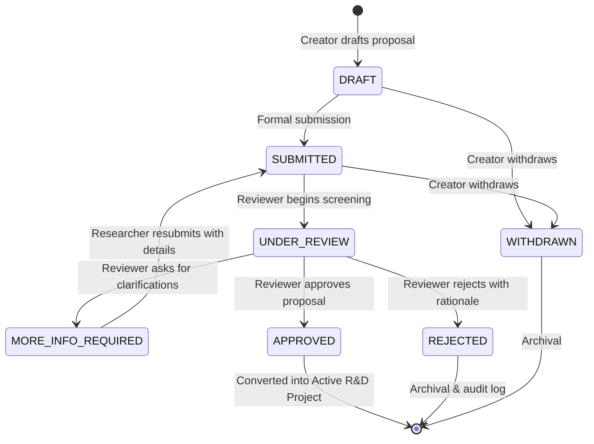

# EGOLYTICS MASTER PROMPT 02: PROJECT INTAKE & APPLICATION WORKFLOWS
**Platform:** EgoLytics – Research & Development Management Tool  
**Parent Ecosystem:** CRM nErgy Enterprise AI Platform  
**Phase:** Master Prompt 02 of 16  
**Requirement Focus:** Requirement 2 – Project Intake and Application Workflows  
**Status:** FULLY IMPLEMENTED & PRODUCTION READY  

---

## 1. Requirement & Business Context

According to the client specification document (`EgoLytics - R_D Management Tool.docx`):
> "The platform must manage the pipeline of proposals and projects, ensuring that research initiatives align with strategic priorities, resource availability, and risk tolerance... avoiding duplication of research, and making explicit decisions to continue, modify, or terminate projects."

Requirement 2 mandates a formal, auditable intake system where research ideas and proposals cannot simply bypass governance. Every initiative must be documented, submitted, formally screened, reviewed, and explicitly approved before converting into an active R&D project.

---

## 2. Intake State Machine Architecture

The Project Intake subsystem implements a strict finite state machine (FSM) enforcing transition rules and reviewer accountability:



### State Machine Transition Rules:
1. **DRAFT:** The researcher creates and edits the proposal privately. It does not appear in the active reviewer screening queue.
2. **SUBMITTED:** The proposal is assigned a human-readable sequential reference code (e.g., `PROP-2026-0001`), immutable submitter ID, and timestamp. It enters the review queue.
3. **UNDER_REVIEW:** An assigned reviewer or R&D committee member begins formal screening.
4. **MORE_INFO_REQUIRED:** The reviewer pauses screening to request specific clarifications, test data, or bill of materials in `moreInfoNotes`. The proposal returns to the researcher for updates.
5. **APPROVED (Atomic Transaction):** The reviewer approves the proposal. The system atomically executes:
   - Sets proposal `status = 'APPROVED'`.
   - Records reviewer ID, review comments, and approval timestamp.
   - Instantiates a live `ErpProject` record (`projectType: 'R_AND_D'`) pre-populated with proposal budget, category, timelines, ROI, and risk metrics.
   - Binds `convertedProjectId` on the proposal record.
   - Automatically maps `ProjectStrategicAlignment` if a target strategic goal was chosen.
   - Emits an activity log into the `activities` audit stream.
6. **REJECTED:** The reviewer rejects the proposal with a mandatory explanation stored in `rejectionReason`. No project is instantiated.
7. **WITHDRAWN:** The creator cancels an unapproved proposal.

---

## 3. Database Schema: `project_proposals`

The `project_proposals` table was created via safe additive migration with foreign key cascades and composite indexes:

```prisma
model ProjectProposal {
  id                      String                     @id @default(cuid())
  tenantId                String
  tenant                  Tenant                     @relation(fields: [tenantId], references: [id], onDelete: Cascade)
  referenceNumber         String
  title                   String
  summary                 String?                    @db.Text
  description             String?                    @db.LongText
  category                String                     @default("Product Innovation")
  problemStatement        String?                    @db.Text
  expectedOutcomes        String?                    @db.Text
  estimatedBudget         Decimal                    @default(0.00) @db.Decimal(12, 2)
  estimatedDurationMonths Int                        @default(6)
  proposedStartDate       DateTime?
  expectedCompletionDate  DateTime?
  submittingUserId        String?
  submittingUser          User?                      @relation("SubmittedProposals", fields: [submittingUserId], references: [id], onDelete: SetNull)
  status                  String                     @default("DRAFT")
  reviewerId              String?
  reviewer                User?                      @relation("ReviewedProposals", fields: [reviewerId], references: [id], onDelete: SetNull)
  reviewComments          String?                    @db.Text
  rejectionReason         String?                    @db.Text
  moreInfoNotes           String?                    @db.Text
  convertedProjectId      String?                    @unique
  convertedProject        ErpProject?                @relation("ProposalToProject", fields: [convertedProjectId], references: [id], onDelete: SetNull)
  strategicGoalId         String?
  strategicGoal           StrategicGoal?             @relation(fields: [strategicGoalId], references: [id], onDelete: SetNull)
  expectedRoi             Float                      @default(50.0)
  riskAssessment          String?                    @default("MEDIUM")
  feasibilityScore        Float                      @default(70.0)
  createdAt               DateTime                   @default(now())
  updatedAt               DateTime                   @updatedAt

  @@index([tenantId])
  @@index([status])
  @@index([submittingUserId])
  @@index([reviewerId])
  @@index([strategicGoalId])
  @@index([tenantId, referenceNumber])
  @@map("project_proposals")
}
```

---

## 4. REST API Endpoint Reference

| Method | Endpoint | Description | Permitted Roles |
| :--- | :--- | :--- | :--- |
| `GET` | `/api/rd/intake` | List proposals with status, category & pagination filters | All R&D Roles |
| `POST` | `/api/rd/intake` | Create new proposal (Draft or Submitted) | All R&D Roles |
| `GET` | `/api/rd/intake/:id` | Fetch full proposal record with reviewer remarks | All R&D Roles |
| `PUT` | `/api/rd/intake/:id` | Update proposal fields (Draft / More Info stages) | Author / Reviewer |
| `POST` | `/api/rd/intake/:id/submit` | Transition proposal from `DRAFT` to `SUBMITTED` | Author |
| `POST` | `/api/rd/intake/:id/review` | Trigger `START_REVIEW` or `REQUEST_INFO` | Reviewer / Exec |
| `POST` | `/api/rd/intake/:id/approve` | Atomic approval and conversion to `ErpProject` | Reviewer / Exec |
| `POST` | `/api/rd/intake/:id/reject` | Reject proposal with mandatory `rejectionReason` | Reviewer / Exec |
| `POST` | `/api/rd/intake/:id/withdraw`| Withdraw pending proposal | Author |

---

## 5. Atomic Conversion Workflow Deep-Dive

When `/api/rd/intake/:id/approve` is called, `rdIntakeService.js` wraps all operations in an atomic Prisma transaction (`prisma.$transaction`):

```javascript
return await prisma.$transaction(async (tx) => {
  // 1. Calculate multi-factor priority score from proposal metrics
  const riskScore = proposal.riskAssessment === 'HIGH' ? 70.0 : proposal.riskAssessment === 'LOW' ? 25.0 : 45.0;
  const roiScore = proposal.expectedRoi || 60.0;
  const feasibility = proposal.feasibilityScore || 70.0;
  const alignmentVal = proposal.strategicGoalId ? 80.0 : 40.0;
  const compositePriorityScore = (roiScore * 0.35) + (alignmentVal * 0.25) + (feasibility * 0.20) + ((100 - riskScore) * 0.20);

  // 2. Instantiate live R&D Project Record
  const project = await tx.erpProject.create({
    data: {
      tenantId,
      name: proposal.title,
      client: `Internal R&D / ${proposal.category}`,
      budget: proposal.estimatedBudget || 0,
      spent: 0,
      progress: 5,
      status: 'Planning',
      manager: reviewerName,
      assignedUserId: proposal.submittingUserId || reviewerId,
      projectType: 'R_AND_D',
      priority: compositePriorityScore >= 75 ? 'CRITICAL' : compositePriorityScore >= 60 ? 'HIGH' : 'MEDIUM',
      priorityScore: parseFloat(compositePriorityScore.toFixed(1)),
      riskScore,
      roiScore,
      feasibilityScore: feasibility,
      strategicCategory: proposal.category,
      stage: 'APPROVED_INTAKE',
    },
  });

  // 3. Mark proposal as APPROVED and bind converted project
  const updatedProposal = await tx.projectProposal.update({
    where: { id: proposalId },
    data: {
      status: 'APPROVED',
      reviewerId,
      reviewComments: reviewComments || 'Approved and converted to active R&D Project.',
      convertedProjectId: project.id,
    },
  });

  // 4. Automatically link ProjectStrategicAlignment if goal was defined
  if (proposal.strategicGoalId) {
    await tx.projectStrategicAlignment.create({
      data: {
        tenantId,
        projectId: project.id,
        goalId: proposal.strategicGoalId,
        alignmentRationale: `Auto-aligned upon intake approval (${proposal.referenceNumber})`,
        impactWeight: 1.0,
      },
    });
  }

  // 5. Emit audit trail activity
  await tx.activity.create({
    data: {
      tenantId,
      userId: reviewerId,
      type: 'STATUS_CHANGED',
      title: `Proposal Approved: ${proposal.referenceNumber}`,
      description: `Proposal "${proposal.title}" approved and converted into R&D Project "${project.name}".`,
      metadata: { proposalId: proposal.id, projectId: project.id },
    },
  });

  return { proposal: updatedProposal, project };
});
```

---

## 6. Frontend UI: `RdIntake.jsx`

Surfaced in `frontend/src/pages/rd/RdIntake.jsx`:
- **Intake Pipeline KPI Dashboard:** Total proposals, proposed pipeline budget, screening queue count, and historical approval rate.
- **Workflow State Filter Tabs:** Dedicated quick-filters for `All Proposals`, `Submitted`, `Under Review`, `Clarifications Needed`, `Approved`, `Rejected`, and `Drafts`.
- **Proposal Submission Modal:** Complete proposal drafting interface with problem statement, outcomes, budget, duration, strategic goal selector, ROI, and risk assessment sliders.
- **Reviewer Action Desk:** Integrated screening desk allowing reviewers to seamlessly progress screening, submit clarification inquiries to authors, execute atomic approvals, or issue formal rejections.

---

## 7. Verification Evidence

The entire intake lifecycle was subjected to automated verification in `backend/test_egolytics_master_02.js`:
- `TC-05`: Draft creation passed (`PROP-2026-0003`).
- `TC-06`: Submission transition to `SUBMITTED` passed.
- `TC-07`: Request for clarification transition to `MORE_INFO_REQUIRED` passed.
- `TC-08`: Author resubmission passed.
- `TC-09`: Atomic approval and project creation verified (`projectType: 'R_AND_D'`).
- `TC-09b`: Automatic `ProjectStrategicAlignment` verified.
- `TC-10`: Formal rejection workflow with rejection reason verified.
