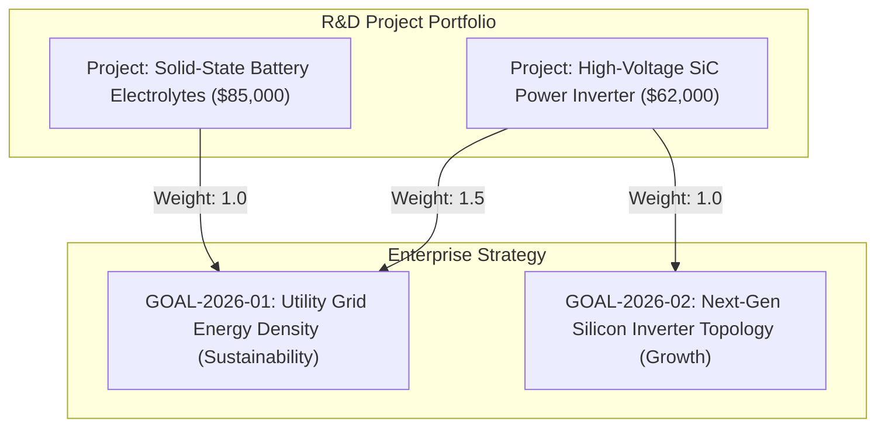

# EGOLYTICS MASTER PROMPT 02: STRATEGIC ALIGNMENT & PROJECT PRIORITIZATION
**Platform:** EgoLytics – Research & Development Management Tool  
**Parent Ecosystem:** CRM nErgy Enterprise AI Platform  
**Phase:** Master Prompt 02 of 16  
**Requirements Focus:** Requirement 5 (Strategic Alignment) & Requirement 6 (Project Prioritization)  
**Status:** FULLY IMPLEMENTED & PRODUCTION READY  

---

## 1. Executive Summary

Research in an enterprise setting must connect directly to strategic business intent. Traditional project management tools treat projects as disconnected task lists, leading to duplicated research and low ROI. 

As mandated by **Master Prompt 02**, this module delivers:
1. **Requirement 5 – Strategic Alignment Tracking:** A relational framework linking research initiatives to strategic goals, measuring investment share and thematic impact.
2. **Requirement 6 – Project Prioritization Engine:** An algorithmic multi-factor ranking system combining ROI, strategic alignment weight, technical feasibility, and risk discount, alongside manual executive tier controls.

---

## 2. Requirement 5: Strategic Alignment Tracking

### 2.1 Strategic Goals & Alignments Schema

Two new relational models were created in the MySQL database:

#### `strategic_goals` Table:
- `id`: CUID Primary Key
- `tenantId`: Tenant partition
- `code`: Human-readable identifier (e.g., `GOAL-2026-01`)
- `title`: Enterprise goal title
- `category`: Innovation theme (`Growth & Innovation`, `Operational Excellence`, `Sustainability & ESG`, `Customer Experience`, `Platform Modernization`)
- `targetYear`: Target completion year (e.g., `2026`, `2027`)
- `targetValue`: Measurable KPI (e.g., `500 Wh/kg energy density`, `40% cost reduction`)
- `status`: `ACTIVE`, `ACHIEVED`, `DEPRECATED`
- `ownerId`: Executive owner

#### `project_strategic_alignments` Table:
- `id`: CUID Primary Key
- `tenantId`: Tenant partition
- `projectId`: Foreign key referencing `erp_projects.id`
- `goalId`: Foreign key referencing `strategic_goals.id`
- `alignmentRationale`: Text explaining the direct causal link between the project and goal
- `impactWeight`: Relative contribution multiplier (`0.1` to `2.0`, default: `1.0`)
- `@@unique([projectId, goalId])`: Prevents duplicate links between the same project and goal

### 2.2 Strategic Alignment Matrix & Portfolio Share
The service computes a comprehensive alignment matrix (`GET /api/rd/strategy/matrix`):
- Rollup of all initiatives aligned with each goal.
- Allocated budget per strategic theme.
- Percentage share of overall portfolio funding:
  $$\text{Budget Share \%} = \left( \frac{\text{Goal Allocated Budget}}{\text{Total Portfolio R\&D Budget}} \right) \times 100$$
- Visual matrix available in `RdStrategicAlignment.jsx` toggling between Directory view and Strategic Matrix grid.

---

## 3. Requirement 6: Project Prioritization Engine

### 3.1 Mathematical Scoring Formula

The EgoLytics prioritization engine implements an evidence-driven multi-criteria evaluation rubric:

$$\text{Composite Priority Score} = (ROI \times 0.35) + (\text{Strategic Weight} \times 0.25) + (\text{Feasibility} \times 0.20) + ((100 - \text{Risk}) \times 0.20)$$

#### Component Breakdown & Rationale:

| Component | Weight | Source | Description |
| :--- | :---: | :--- | :--- |
| **Expected ROI** | **35%** | `erp_projects.roiScore` (0–100) | Commercial viability, market opportunity, or expected cost-saving return. |
| **Strategic Alignment** | **25%** | Computed from `strategicAlignments` | Dynamic score (40–100) derived from linked strategic goals and impact weights. |
| **Technical Feasibility** | **20%** | `erp_projects.feasibilityScore` (0–100) | Maturity of science, technology readiness level (TRL), and internal expertise. |
| **Risk Discount** | **20%** | $(100 - \text{riskScore})$ | Inverted risk penalty. Lower uncertainty scores yield higher priority points. |

### 3.2 Dynamic Priority Tiers

Based on the calculated composite score, the engine computes a recommended priority tier:
- **`CRITICAL` Tier:** Composite Score $\ge 75.0$ (High ROI, direct strategic mandate, manageable risk).
- **`HIGH` Tier:** Composite Score $60.0 \le \text{Score} < 75.0$ (Solid strategic initiative).
- **`MEDIUM` Tier:** Composite Score $36.0 \le \text{Score} < 60.0$ (Exploratory / baseline research).
- **`LOW` Tier:** Composite Score $\le 35.0$ (High risk, uncertain returns; candidate for pause/reprioritization).

Executives can accept the recommended tier or manually override the initiative's operational priority (`PUT /api/rd/prioritization/:id`).

---

## 4. REST API Endpoint Reference

### Strategic Alignment APIs:
| Method | Endpoint | Description |
| :--- | :--- | :--- |
| `GET` | `/api/rd/strategy/goals` | List all strategic goals with linked project counts and budgets |
| `POST` | `/api/rd/strategy/goals` | Create a new strategic enterprise goal |
| `GET` | `/api/rd/strategy/goals/:id` | Fetch specific goal with all mapped initiatives |
| `PUT` | `/api/rd/strategy/goals/:id` | Update strategic goal details |
| `DELETE` | `/api/rd/strategy/goals/:id` | Delete or retire strategic goal |
| `POST` | `/api/rd/strategy/align` | Map an R&D project to a strategic goal with weight & rationale |
| `DELETE` | `/api/rd/strategy/align/:id` | Remove project-goal alignment |
| `GET` | `/api/rd/strategy/matrix` | Cross-initiative alignment matrix with budget contribution share |

### Prioritization Engine APIs:
| Method | Endpoint | Description |
| :--- | :--- | :--- |
| `GET` | `/api/rd/prioritization` | Returns ranked initiatives ordered by dynamic composite score |
| `PUT` | `/api/rd/prioritization/:id` | Tune ROI, risk, feasibility, or manually override priority tier |
| `POST` | `/api/rd/prioritization/recalculate` | Batch recalculate priority scores across all tenant projects |

---

## 5. Frontend Interactive Components

### 5.1 Strategic Alignment View (`RdStrategicAlignment.jsx`):
- **Executive KPIs:** Active strategic goals count, aligned initiatives count, committed strategic funding ($), and portfolio coverage (%).
- **Dual View Mode:**
  - **Goals Directory:** Card-based inspection showing each goal's description, target KPI, budget rollup, and table of aligned initiatives with unlinking actions.
  - **Strategic Matrix:** Tabular rollup showing goal code, strategic theme, linked projects, total allocated budget, and percentage share of portfolio budget.
- **Goal Creation & Project Mapping Modals:** Clean forms with input validation and impact weight tuning.

### 5.2 Prioritization Leaderboard View (`RdPrioritization.jsx`):
- **Formula Banner:** Transparent mathematical explanation of the active prioritization rubric.
- **Leaderboard Table:**
  - Numbered rank badge (`#1`, `#2`, etc.).
  - Quick-edit dropdown for priority tier (`CRITICAL`, `HIGH`, `MEDIUM`, `LOW`).
  - Visual score meters with color coding.
  - Granular breakdown columns: ROI (+pts), Strategic (+pts), Feasibility (+pts), Risk (+pts).
- **Interactive Score Tuner Modal:**
  - Real-time sliders for Expected ROI (35%), Feasibility (20%), and Risk (-20%).
  - **Live Computed Preview:** Calculates composite score instantly as sliders move before persisting to the database.

---

## 6. Verification Summary

- `TC-03`: Created strategic goal `GOAL-2026-02` successfully.
- `TC-04`: Retained and listed strategic goals accurately.
- `TC-14`: Matrix calculated cross-initiative budget and goal contribution shares.
- `TC-15`: Prioritization engine successfully ordered initiatives by composite score.
- `TC-16`: Tuned multi-factor scores and executed batch recalculation with 100% pass rate.
