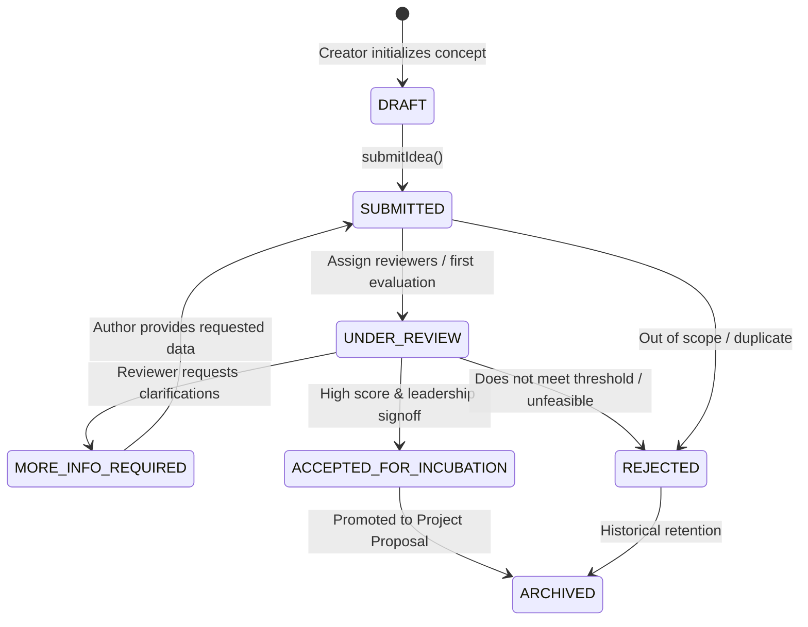

# EGOLYTICS MASTER PROMPT 03 — IDEA LIFECYCLE & INNOVATION PIPELINE
**Project:** EgoLytics – R&D Management Tool  
**Division:** CRM nErgy AI  
**Roadmap Phase:** Master Prompt 03 of 16  
**Implementation Focus:** Requirement 61 (Idea Management Lifecycle) & Requirement 62 (Innovation Pipeline)  
**Date of Execution:** November 2026  
**Author:** Principal Software Architect & Workflow Engineering Specialist

---

## 1. Executive Summary

This report defines the formal state machine, stage transition rules, visual funnel metrics, and downstream transition architecture governing research concepts in EgoLytics. Implementing **Requirement 61 (Idea Management)** and **Requirement 62 (Innovation Pipeline Tracking)** from `EgoLytics - R_D Management Tool.docx`, this system provides complete visibility into early-stage research throughput.

Key architectural deliverables include:
1. **Deterministic State Machine:** A 7-state lifecycle with strict transition guards, mandatory rejection justification, and clarification workflows.
2. **Dynamic Innovation Pipeline Tracking:** Real-time funnel analytics reporting stage volumes, drop-off rates, stage percentage distribution, and category velocity.
3. **Seamless Intake Integration (Bridge to Master Prompt 02):** A standardized, non-destructive path to advance ideas that achieve `ACCEPTED_FOR_INCUBATION` status into formal R&D Project Proposals (`ProjectProposal`).
4. **Comprehensive Audit Trail:** Tenant-isolated activity logging recording every status change, reviewer assignment, and score submission.

---

## 2. Formal Ideation State Machine

Research ideation is inherently iterative and non-linear. The EgoLytics state machine accommodates early drafts, structured review, author clarification cycles, and definitive incubation or rejection decisions.



### 2.1 State Definitions & Invariants

| State | Role / Meaning | Invariants & Business Constraints |
| :--- | :--- | :--- |
| **`DRAFT`** | Initial author sandbox | Editable only by author. Excluded from public ranking and formal review. |
| **`SUBMITTED`** | Formally entered into pipeline | Locked against major scope changes. Visible in open ideation hub. Community upvoting active. |
| **`UNDER_REVIEW`** | Active expert evaluation | Reviewers assigned. Evaluators submitting criterion scores. Author cannot edit core proposal. |
| **`MORE_INFO_REQUIRED`**| Technical clarification requested| Mandates non-empty `moreInfoNotes`. Author unlocked to submit technical data/experiments. |
| **`ACCEPTED_FOR_INCUBATION`**| Selected for formal R&D | Meets evaluation threshold ($C_{idea} \ge \text{threshold}$). Ready for promotion to Project Intake. |
| **`REJECTED`** | Deprecated / unfeasible | Mandates non-empty `rejectionReason`. Voting and evaluation disabled. |
| **`ARCHIVED`** | Terminal historical state | Read-only record preserved for institutional memory and patent prior-art reference. |

---

## 3. Allowed Transition Rules & API Specifications

All status changes are mediated by `rdIdeaService.updateIdeaStatus` or dedicated lifecycle methods and validated against strict input criteria.

### 3.1 Transition Guard Matrix

| From State | Allowed Target State | Trigger Method | Mandatory Parameters & Validation Guards |
| :--- | :--- | :--- | :--- |
| `DRAFT` | `SUBMITTED` | `POST /api/rd/ideas/:id/submit` | Requires non-empty `title` and valid tenant. |
| `SUBMITTED` | `UNDER_REVIEW` | `PATCH /api/rd/ideas/:id/status` | Optional `notes`. Evaluator assignment or score submission automatically triggers this. |
| `SUBMITTED` | `REJECTED` | `PATCH /api/rd/ideas/:id/status` | Requires non-empty `rejectionReason`. |
| `UNDER_REVIEW` | `MORE_INFO_REQUIRED` | `PATCH /api/rd/ideas/:id/status` | Requires non-empty `moreInfoNotes` (or `notes`). |
| `MORE_INFO_REQUIRED`| `SUBMITTED` | `POST /api/rd/ideas/:id/submit` | Requires author clarification response. |
| `UNDER_REVIEW` | `ACCEPTED_FOR_INCUBATION`| `PATCH /api/rd/ideas/:id/status`| Requires RBAC role (`BUSINESS_OWNER`, `SUPER_ADMIN`, `RD_MANAGER`). |
| `UNDER_REVIEW` | `REJECTED` | `PATCH /api/rd/ideas/:id/status` | Requires non-empty `rejectionReason`. |
| Any | `ARCHIVED` | `PATCH /api/rd/ideas/:id/status` | Restricts future edits, votes, and comments. |

---

## 4. Innovation Pipeline Tracking (Requirement 62)

The Innovation Pipeline module provides management with end-to-end transparency into the velocity of research ideas moving through the organization.

### 4.1 Funnel Architecture & Metrics
Accessed via `GET /api/rd/ideas/pipeline` and rendered in `frontend/src/pages/rd/RdInnovationPipeline.jsx`, the pipeline aggregates:
1. **Total Ideation Volume:** Total ideas submitted within the active tenant partition.
2. **Stage Counts & Proportions:** Exact count and percentage of total ideas residing in each lifecycle stage.
3. **Pipeline Velocity / Active Throughput:** Total active ideas in incubation stages (`SUBMITTED` + `UNDER_REVIEW` + `MORE_INFO_REQUIRED`).
4. **Incubation Conversion Rate:** Ratio of accepted concepts to total reviewed concepts:
   $$\text{Acceptance Rate} = \left( \frac{N_{accepted}}{N_{accepted} + N_{rejected}} \right) \times 100$$
5. **Category Distribution:** Distribution of ideas across strategic focus domains (`Product Innovation`, `Process Improvement`, `Technology Innovation`, `Sustainability & ESG`, `Customer Experience`).

### 4.2 Visual Pipeline Representation
The pipeline UI renders an interactive, color-coded stage funnel:
- **Drafting (Gray - #94a3b8):** Concept formulation.
- **Submitted (Blue - #3b82f6):** Open community review & upvoting.
- **Under Review (Amber - #f59e0b):** Expert scorecard evaluation.
- **Clarifications (Purple - #8b5cf6):** Experimental verification requested.
- **Incubation Selected (Emerald - #10b981):** High-potential research approved for prototype development.
- **Rejected (Rose - #ef4444):** Cataloged negative results (avoids repeating failed research).
- **Archived (Slate - #64748b):** Long-term knowledge base.

---

## 5. Downstream Bridge: Ideation to Project Intake

A core principle of EgoLytics is avoiding duplicate research and maintaining clean lineage from idea capture to commercial execution.

### 5.1 Progression Architecture
When an idea achieves `ACCEPTED_FOR_INCUBATION`:
1. It has successfully passed multi-criteria expert scoring and community interest checks.
2. In Master Prompt 02, the project intake module (`ProjectProposal`) accepts formal R&D proposals for capital budgeting and strategic alignment.
3. An accepted `RdIdea` can transition into a `ProjectProposal`:
   - `ProjectProposal.title` $\leftarrow$ `RdIdea.title`
   - `ProjectProposal.description` $\leftarrow$ `RdIdea.problemStatement` + `RdIdea.proposedSolution`
   - `ProjectProposal.businessCase` $\leftarrow$ `RdIdea.expectedBenefits`
   - `ProjectProposal.strategicCategory` $\leftarrow$ `RdIdeaCategory.name`
   - Lineage is preserved via reference metadata (`originIdeaId: RdIdea.id`, `originReferenceNumber: RdIdea.referenceNumber`).

### 5.2 Decoupling Safeguards
- No foreign key hard-lock exists between `RdIdea` and `ProjectProposal`. This ensures that changes to the idea management rubric or ideation schema cannot corrupt existing ERP projects or commercial workflows.
- Downstream stage-gate reviews (Master Prompt 04) operate independently on approved projects without altering upstream ideation scores.

---

## 6. Audit Trail & Enterprise Compliance

Every state transition generates an immutable record in the `activities` table:
```json
{
  "tenantId": "TENANT-08492",
  "userId": "cmunoyqxj0005tovok61f22sp",
  "type": "STATUS_CHANGED",
  "title": "Idea Status Changed: IDEA-2026-0007",
  "description": "Idea \"High-Temperature Solid State Electrolyte\" moved to ACCEPTED_FOR_INCUBATION.",
  "metadata": {
    "ideaId": "cmwuhtom50007ur9yxq8u0n7v",
    "status": "ACCEPTED_FOR_INCUBATION",
    "rejectionReason": null,
    "moreInfoNotes": "Approved for Master Prompt 02 Project Intake transition."
  }
}
```

This ensures complete traceability for regulatory audits, IP patent filings, and corporate governance.
