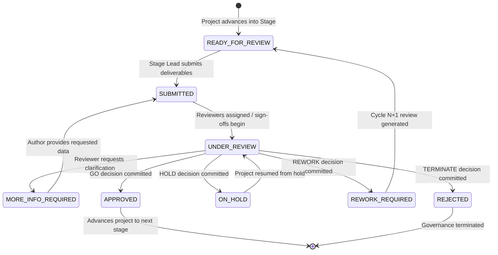

# EGOLYTICS MASTER PROMPT 04 — STAGE CONFIGURATION & GOVERNANCE WORKFLOW
**Project:** EgoLytics – R&D Management Tool  
**Division:** CRM nErgy AI  
**Roadmap Phase:** Master Prompt 04 of 16  
**Implementation Focus:** Stage Architecture, Criteria Validation & Gate Lifecycle Rules  
**Date of Execution:** November 2026  
**Author:** Principal Enterprise Software Architect & Workflow Engineering Specialist

---

## 1. Executive Summary

This document specifies the technical mechanics of **Stage-Gate Innovation Lifecycles, Criteria Validation, and Decision Gate Lifecycles** in EgoLytics. Unlike conventional, fixed-state project management tools, EgoLytics treats innovation as an iterative, evidence-driven process. Research projects must demonstrate scientific and commercial viability at explicit decision checkpoints before advancing to subsequent stages.

This guide details the configurable template architecture, the standard 5-stage enterprise baseline, entry and exit criteria validation, and the complete state machine governing gate reviews.

---

## 2. Stage Architecture & Configurable Templates

EgoLytics supports configurable stage templates. The client document does not mandate a rigid, unchangeable stage count; therefore, organizations can tailor stage counts, gate definitions, criteria, and roles to specific R&D divisions (e.g. Chemical/Hardware R&D vs. Software/AI R&D).

### 2.1 Reusable Stage Templates (`RdStageTemplate`)
- **Tenant Scoping:** Templates belong to a specific tenant organization.
- **Versioning:** Templates maintain a sequential `version` number ($1, 2, 3 \dots$). When an active template's stages or criteria are altered, existing in-flight projects maintain their binding to their initialized `templateVersion`, ensuring that historical gate reviews are never corrupted.
- **Default Flag:** Exactly one active template per tenant is marked `isDefault: true` to streamline project initialization.

### 2.2 Standard 5-Stage Innovation Process Baseline
Upon tenant activation, EgoLytics provisions the following enterprise-grade R&D lifecycle:

```mermaid
flowchart LR
    S1["Stage 1: Discovery & Ideation"] --> G1["Gate 1: Concept Approval"]
    G1 --> S2["Stage 2: Feasibility Assessment"]
    S2 --> G2["Gate 2: Feasibility Sign-Off"]
    G2 --> S3["Stage 3: Research & Development"]
    S3 --> G3["Gate 3: Prototype Review"]
    G3 --> S4["Stage 4: Validation & Pilot Testing"]
    S4 --> G4["Gate 4: Pre-Commercialization"]
    G4 --> S5["Stage 5: Commercialization & Transfer"]
    G5["Gate 5: Launch Gate"]
    S5 --> G5
    G5 --> Done["Production Handover"]
```



#### Detailed Stage Breakdown:

| Stage # | Stage Name | Responsible Role | Key Deliverables | Gate Name | Gate Approval Policy |
| :---: | :--- | :--- | :--- | :--- | :--- |
| **1** | **Discovery & Ideation** | `RESEARCH_LEAD` | Concept Brief, Problem Statement, Prior-Art Search | **Gate 1: Concept Review** | `ALL_MUST_APPROVE` |
| **2** | **Feasibility Assessment** | `TECH_LEAD` | Feasibility Report, Risk Matrix, Initial Budget | **Gate 2: Feasibility Gate** | `ALL_MUST_APPROVE` |
| **3** | **Research & Development** | `PRINCIPAL_SCIENTIST` | Working Alpha Prototype, Test Datasets, IP Disclosure | **Gate 3: Prototype Gate** | `ALL_MUST_APPROVE` |
| **4** | **Validation & Pilot Testing** | `QA_DIRECTOR` | Pilot Run Data, Regulatory Sign-Off, Failure Analysis | **Gate 4: Pre-Commercial Gate** | `ALL_MUST_APPROVE` |
| **5** | **Commercialization & Transfer** | `COMMERCIAL_LEAD` | Manufacturing Transfer, Production Sign-off, IP Claims | **Gate 5: Launch Gate** | `ALL_MUST_APPROVE` |

---

## 3. Stage Entry & Exit Criteria Engine

Progression between stages is gated by structured criteria (`RdStageCriterion`).

### 3.1 Criteria Classification
1. **`ENTRY` Criteria:** Conditions that must be satisfied before a project can enter and commence active work in a stage (e.g. "Gate 1 formal approval recorded", "Safety clearance obtained").
2. **`EXIT` Criteria:** Deliverables and technical benchmarks that must be verified before the current stage can be submitted to its decision gate.
3. **Mandatory vs. Optional:** If `isMandatory: true`, the gate submission API (`POST /api/rd/governance/reviews/:id/submit`) blocks submission if conditions or required evidence are missing.
4. **Evidence Flag (`evidenceRequired`):** If true, at least one verified supporting document (`RdGateEvidence`) must be attached to the review cycle prior to submission.

### 3.2 Criteria Validation Algorithm
```javascript
// Verification executed during gate submission
const mandatoryExitCriteria = stage.criteria.filter(c => c.isMandatory && c.type === 'EXIT');
const criteriaRequiringEvidence = mandatoryExitCriteria.filter(c => c.evidenceRequired);

if (criteriaRequiringEvidence.length > 0) {
  const attachedCriterionIds = new Set(review.evidence.map(e => e.criterionId).filter(Boolean));
  const hasGeneralEvidence = review.evidence.length > 0;

  if (!hasGeneralEvidence && criteriaRequiringEvidence.some(c => !attachedCriterionIds.has(c.id))) {
    throw new Error('Mandatory exit criteria require attached research evidence before submission.');
  }
}
```

---

## 4. Decision Gate Lifecycle State Machine

A Decision Gate represents a formal evaluation checkpoint. Each gate review cycle (`RdGateReview`) transitions through a strictly controlled state machine.



### 4.1 State Definitions

| Review Status | Meaning & System Invariants |
| :--- | :--- |
| **`READY_FOR_REVIEW`** | Initial cycle sandbox. Author compiling evidence, meeting deliverables. |
| **`SUBMITTED`** | Stage owner submitted deliverables. System locks scope changes. |
| **`UNDER_REVIEW`** | Gatekeepers actively inspecting evidence and entering sign-offs. |
| **`MORE_INFO_REQUIRED`**| Reviewers requested additional lab data or technical clarifications. |
| **`APPROVED`** | Gate passed with authorized `GO_CONTINUE` decision. Project advances. |
| **`ON_HOLD`** | Project paused pending resources or external conditions. Progression blocked. |
| **`REWORK_REQUIRED`** | Technical modifications required. Review marked rework; Cycle $N+1$ created. |
| **`REJECTED`** | Project terminated permanently via `TERMINATE_KILL` decision. Data preserved. |

---

## 5. Transition Rules & Progression Guard Rails

### 5.1 Progression Safeguards
1. **No Gate Skipping:** A project cannot leapfrog from Stage 1 to Stage 3 without passing Gate 1 and Gate 2.
2. **Hold Blocker:** Projects with `governanceStatus = 'ON_HOLD'` are blocked by the backend API from submitting reviews or executing stage advancements.
3. **Termination Finality:** Projects marked `TERMINATED` are permanently locked from ordinary stage progression. All historical evidence and decision logs remain preserved.
4. **Idempotency:** Re-submitting a decision or initializing governance twice returns the existing instance without creating duplicate records.

---

## 6. Real-World Governance Workflow Example

### Scenario: Advanced Solid-State Electrolyte Initiative
1. **Initialization:** R&D Project initialized at Stage 1 ("Discovery & Ideation"). Review cycle for Gate 1 automatically generated.
2. **Evidence Attachment:** Author uploads `Prior-Art Patent Analysis Report.pdf` and maps it to the literature exit criterion.
3. **Submission:** Project lead calls `POST /api/rd/governance/reviews/:id/submit`. Review moves to `SUBMITTED`.
4. **Reviewer Assignment:** Technical Lead and Chief Scientist assigned as Gatekeepers. Review status moves to `UNDER_REVIEW`.
5. **Sign-Offs:** Chief Scientist records formal sign-off: `APPROVE`, noting "Sound concept and strong IP defense".
6. **Authoritative Decision:** Business Owner commits `GO_CONTINUE` decision with documented budget allocation.
7. **Stage Advancement:**
   - Review 1 marked `APPROVED`.
   - Project advances to Stage 2 ("Feasibility Assessment").
   - `ErpProject.stage` updated to "Feasibility Assessment".
   - Review cycle for Gate 2 automatically created in `READY_FOR_REVIEW` state.
   - Stage history logs `ADVANCED` event with actor and timestamp.
